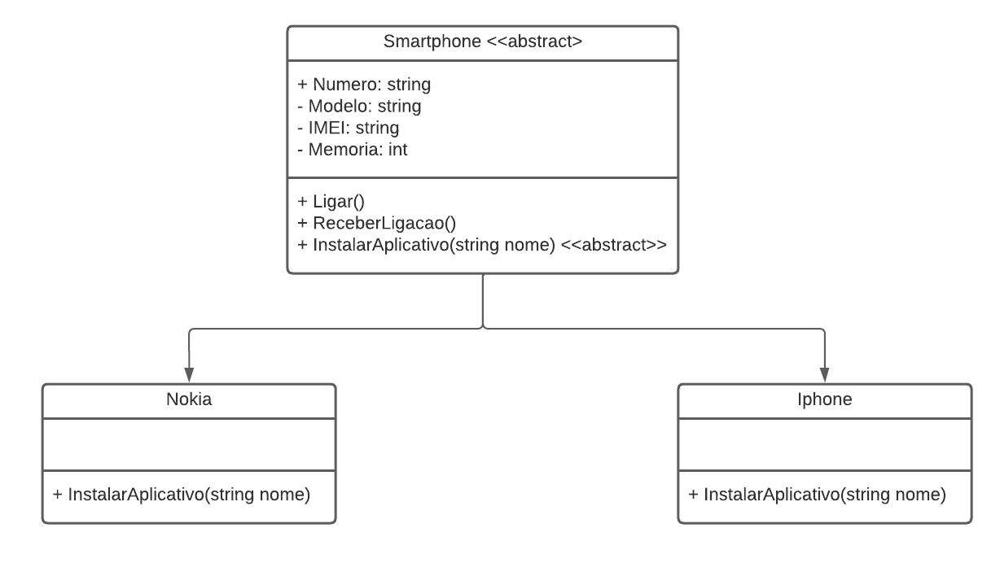

# DIO - Trilha .NET - Programação orientada a objetos
www.dio.me

## Desafio de projeto
Para este desafio, você precisará usar seus conhecimentos adquiridos no módulo de orientação a objetos, da trilha .NET da DIO.

## Contexto
Você é responsável por modelar um sistema que trabalha com celulares. Para isso, foi solicitado que você faça uma abstração de um celular e disponibilize maneiras de diferentes marcas e modelos terem seu próprio comportamento, possibilitando um maior reuso de código e usando a orientação a objetos.

## Proposta
Você precisa criar um sistema em .NET, do tipo console, mapeando uma classe abstrata e classes específicas para dois tipos de celulares: Nokia e iPhone. 
Você deve criar as suas classes de acordo com o diagrama abaixo:



## Regras e validações
1. A classe **Smartphone** deve ser abstrata, não permitindo instanciar e servindo apenas como modelo.
2. A classe **Nokia** e **Iphone** devem ser classes filhas de Smartphone.
3. O método **InstalarAplicativo** deve ser sobrescrito na classe Nokia e iPhone, pois ambos possuem diferentes maneiras de instalar um aplicativo.

## Solução
O código está pela metade, e você deverá dar continuidade obedecendo as regras descritas acima, para que no final, tenhamos um programa funcional. Procure pela palavra comentada "TODO" no código, em seguida, implemente conforme as regras acima.

## Migrar para .NET 8

Siga estes passos para migrar o projeto para o .NET 8:

1. **Instale o SDK do .NET 8**
   - Baixe e instale o SDK oficial em: [https://dotnet.microsoft.com/en-us/download/dotnet/8.0](https://dotnet.microsoft.com/en-us/download/dotnet/8.0)
   - Verifique com `dotnet --list-sdks` e `dotnet --info`.

2. **Atualize o Target Framework do projeto**
   - Abra o arquivo `.csproj` do projeto e altere a propriedade `TargetFramework` para `net8.0`:
     ```xml
     <PropertyGroup>
       <TargetFramework>net8.0</TargetFramework>
     </PropertyGroup>
     ```
   - Se preferir usar o Visual Studio: clique com o botão direito no projeto -> __Properties__ -> __Target Framework__ e selecione `.NET 8.0`.

3. **Atualize (ou remova) `global.json` se existir**
   - Se houver `global.json` fixando uma versão antiga do SDK, atualize `sdk.version` para uma versão 8.x compatível ou remova o arquivo.
   - Exemplo:
     ```json
     {
       "sdk": { "version": "8.0.100" }
     }
     ```

4. **Atualize pacotes NuGet**
   - Rode `dotnet restore` e atualize pacotes que não sejam compatíveis com .NET 8.
   - Use `dotnet list package --outdated` para identificar pacotes antigos e `dotnet add package <Package> --version <Versão>` para atualizar.

5. **Build e testes**
   - Execute:
     ```sh
     dotnet clean
     dotnet restore
     dotnet build
     dotnet test
     ```
   - Corrija APIs obsoletas ou breaking changes conforme os erros de compilação.

6. **Visual Studio**
   - Se usar Visual Studio, garanta que a versão instalada suporte .NET 8 (atualize o Visual Studio se necessário) via __Visual Studio Installer__.
   - Após instalar SDK compatível, abra o projeto e altere o __Target Framework__ nas propriedades do projeto.

7. **Ajustes opcionais**
   - Atualize `LangVersion` se quiser recursos de linguagem mais recentes.
   - Verifique `implicit usings` e `nullable` se estiverem ativos.

**Obs:** Sempre faça commit/branch antes da migração e teste em CI/CD.